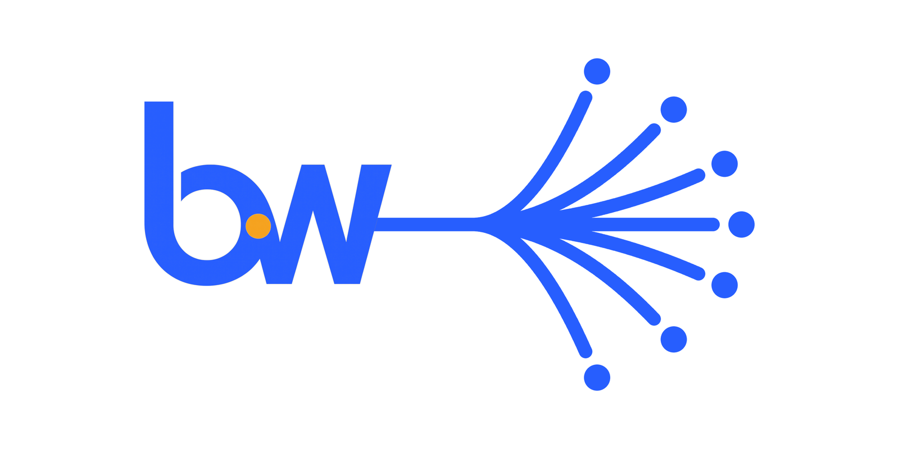

<picture>
  <source media="(prefers-color-scheme: dark)" srcset="assets/bellwire-header-dark-1600.png">
  
</picture>

**Bellwire** is a self-hosted notification hub. One installation serves many
apps. An app's backend says who should hear what and when; Bellwire decides how:
devices, languages, queues, retries, Apple and Google.

- **One call in, every device reached.** Bellwire fans each send out to the
  app's devices in batches, with a separate lane so urgent sends never wait
  behind large ones.
- **Each person in their own language.** Arabic and English first.
- **Yours to run.** One Go binary on Postgres, started with Docker Compose.

**Status:** phase 1, push notifications through Apple APNs and Google FCM, is
being built.

The code: [bellwire/bellwire](https://github.com/bellwire/bellwire)
